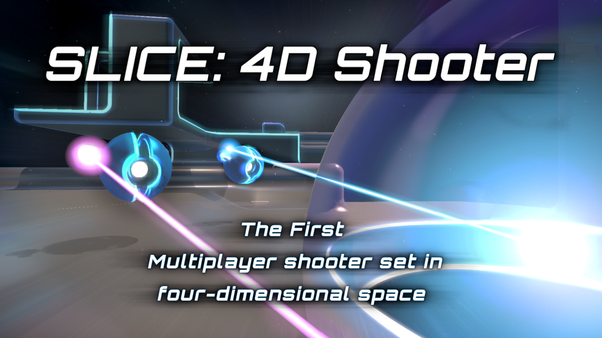

# [](https://github.com/maffi44/slice-4d-shooter)
[](https://opensource.org/licenses/AGPL-3.0)
[](https://rust-lang.org)
[](https://windows.com)
[](https://linux.org)
[](https://apple.com)
# Slice: 4D Shooter

**Slice** is a competitive multiplayer first-person shooter that takes place in a **true four-dimensional space**. It is developed as free and open-source software under the **AGPLv3** license.
Our **goal** is to create the first **free and open-source esports shooter in 4D space**.  [**Help us create it!**](https://slice4d.info/#donate)

## Resources
*   **[Website](https://slice4d.info/)**
*   **[Trailer](https://youtu.be/yeCqfqE4ylk)**
*   **[Video Tutorial](https://youtu.be/Pl355uSTBLc)**
*   **[Download auto-update version for Windows on Itch.io](https://maffi44.itch.io/slice4d)**

## Technology Overview

**Slice: 4D Shooter** is built on a **custom game engine**, developed from scratch in **Rust**.
The project is currently in playable prototype stage. 

Up to and including commit [`f3e2128`](https://github.com/maffi44/slice-4d-shooter/commit/f3e2128) (2026-11-03), the entire codebase was written manually, without the use of large language models or AI-assisted code generation tools (the only exception is the ```tv_hash``` and ```tv_noise``` functions in ```raymarch_shader.wgsl```).
Starting with the engine refactoring that follows that commit (November 2026), the project is developed with the help of AI coding agents to speed up development: the author designs the architecture, discusses and reviews every change, and the agents implement it (see [Development with AI agents](#development-with-ai-agents)).

**Core engine features include:**
*   **4D Rendering:** Utilizes a Signed Distance Field (SDF) algorithm to render four-dimensional geometry.
*   **4D Physics:** Features a custom-built physics engine, also SDF-based, to handle movement and collisions in 4D space.
*   **Actor-based Architecture:** Uses actors with per-world message queues and simulation state.
*   **Destructible Environment:** Supports environment destruction using the SDF-based physics and rendering systems.
*   **Multiplayer Networking:** Implements a temporary client-based networking model for multiplayer gameplay and game state synchronization.
*   **Cross-Platform Support:** The game runs on Windows, Linux, and macOS.

## Development with AI agents

The repository keeps working instructions, current tasks and their history separate:

* **[AGENTS.md](AGENTS.md)**: working principles, repository map, verification, release restrictions and issue conventions.
* **[Engine architecture](docs/engine-architecture.md)**: the current implementation reference, with links to decision history.
* **[Issue index](issues/README.md)**: tasks grouped by area and priority. Each task has a permanent directory, a concise main file, and a sibling `-context.md` file when extended discussion is needed. Context preserves the rationale, alternatives, decisions and implementation history, and can link to earlier contexts.
* **Open filenames** have no date: `<slug>.md` and `<slug>-context.md`. High-priority tasks prefix both with `high-priority-`.
* **Completed filenames** are `done-YYYY-MM-DD-<stem>.md` and `done-YYYY-MM-DD-<stem>-context.md`, retaining any priority prefix in `<stem>`. The date is the completion date; rename only after the author's confirmation.
* **Links between tasks point to their permanent directories**, so priority changes and completion do not break them. The main/context files link directly to each other; only those local links normally need updating when renamed.

Read the main task first and follow relevant context links when the reasons behind a decision matter. Historical proposals are preserved as history, not silently promoted to current requirements.

## License

The project's original source code, including the client and servers, is licensed under the **GNU Affero General Public License, version 3 or later** (`AGPL-3.0-or-later`). Third-party components retain their own licenses.  
See the [`LICENSE.txt`](LICENSE.txt) file for full terms. The Windows installer includes `LICENSE.txt`, `CREDITS.md` and the bundled WinSparkle/Matchbox notices (`licenses/`).

This project incorporates third-party components under their respective licenses:

*   **WinSparkle** (located in the `dll/` directory): Copyright (c) 2009-2025 Vaclav Slavik. Licensed under the MIT license reproduced in [`dll/LICENSE.txt`](dll/LICENSE.txt). This software includes components from the OpenSSL Project.
*   **Modified `matchbox_signaling` crate**: The original work is licensed under either **MIT** or **Apache 2.0**. The modified source code, original licenses, README, and a `NOTICE` file describing the changes are located in the `matchbox_signaling_modified/` directory.
*   **Audio Assets**: Various sound effects are used under **CC0 1.0**, **CC BY 3.0**, and **CC BY 4.0** licenses. A complete list with attribution is available in the [`CREDITS.md`](CREDITS.md) file.

### Original Assets and Trademark

*   **Original Art & Assets**: The project's original assets by Timofei Molokov (excluding the `media/` directory) are licensed under **Creative Commons Attribution-ShareAlike 4.0 International (CC BY-SA 4.0)**.
*   **Media Directory**: All files in the `media/` directory are **All Rights Reserved** and are the exclusive property of Timofei Molokov. They are included for demonstration only and are not covered by the AGPL-3.0 or CC BY-SA 4.0 licenses.
*   **Project Name**: The name **"Slice: 4D Shooter"** and its associated logo are trademarks and are **not covered** by the AGPL or CC BY-SA 4.0 licenses. If you create a fork of this project, please choose a unique, original name for your work.

### For a detailed breakdown of licensing and attribution, please see the full [`CREDITS.md`](CREDITS.md) file.


## Technical Requirements

The chosen method for visualizing 4D geometry (an SDF-based rendering algorithm) is demanding on the GPU. A **minimum recommended video card** for a smooth experience is an **Nvidia RTX 3060** or its equivalent.

For weaker hardware, the Slice prototype includes tools to control performance:

*   **Lower Resolution:** Press `i` to decrease the rendering resolution. Each press reduces it by 5%, which can increase framerate.
*   **Higher Resolution:** Press `O` to increase the rendering resolution by 5%.
*   **Shadows:** Press `P` to toggle shadow rendering on/off. Disabling shadows can improve performance.

Slice: 4D Shooter is in a playable prototype stage, and we have observed launch issues on some older laptops with integrated graphics and other specific hardware, particularly on Windows.

If you encounter technical problems (crashes, bugs, performance issues), please report them:
*   By creating an `issue` in our [GitHub repository](https://github.com/maffi44/slice-4d-shooter/issues).
*   Or by sending a detailed report to: **slice4d-bugs-report@pm.me**.

**Please include in your report:**
1.  A description of the error or problem.
2.  Your hardware specifications (GPU model, CPU, RAM).
3.  Your operating system version.

## Build the Game Client

[**Here you can download the game client version for Windows that is ready to install and auto-updates.**](https://maffi44.itch.io/slice4d)

### To Build the project, you need to install the **Rust Programming Language** and the **Cargo** utility. 

For unix-like operating systems:
```bash
curl --proto '=https' --tlsv1.2 -sSf https://sh.rustup.rs | sh
```
For Windows, you need to download `rustup-init.exe` according to [**this link**](https://rust-lang.github.io/rustup/installation/other.html).

### Build on Debian-based Linux distros

Install dependencies:

```bash
apt install build-essential pkg-config libasound2-dev
```

Build the game client:

```bash
cargo build --release --bin game-client
```

### Build on RHEL-based Linux distros

Install dependencies:

```bash
dnf install gcc make glibc-devel pkgconf-pkg-config alsa-lib-devel
```

Build the game client:

```bash
cargo build --release --bin game-client
```

### Build on macOS (Apple Silicon)

Build the game client:

```bash
cargo build --release --bin game-client --target aarch64-apple-darwin
```

### Build on Windows 10/11

Install dependencies:

```powershell
rustup target add x86_64-pc-windows-msvc
```

Build the game client:

```powershell
cargo build --release --bin game-client-without-autoupdate --target x86_64-pc-windows-msvc
```

Other client binaries: `game-client` (the released client with WinSparkle auto-update) and `game-client-with-windows-command-line` (with a console window that shows the log).

---

## Launching the game

Build output is in `target/<target>/release/`. The repository's `.cargo/config.toml` defaults to `x86_64-unknown-linux-gnu`; Windows and macOS commands above select their target explicitly.

On Linux, check the client version from the repository root:

```bash
./target/x86_64-unknown-linux-gnu/release/game-client --version
```

For the Windows build command above, run `target\x86_64-pc-windows-msvc\release\game-client-without-autoupdate.exe`; for Apple Silicon, run `target/aarch64-apple-darwin/release/game-client`. Pass the same CLI options to the chosen executable.

If you are going to connect to the official servers, then the version of the game client **must match the version** of the **[latest release](https://github.com/maffi44/slice-4d-shooter/releases)** of the game.

Actors and devices request their gameplay sounds directly. Instances share decoded buffers for the session. Headless worlds skip sound decoding. Each cached map keeps one actor set ready for its next activation. While a destination map loads, the current world continues ticking, including in older maps with `async_load: false`.

After launching the graphical client, GPU initialization and initial-map preparation run in the background while the window continues processing events. The window is initially blank; the splash appears once rendering is ready. Shader compilation may take some time, depending on your computer. Closing during loading hides the window immediately; the process finishes after any already-running initialization step returns. See [engine startup](docs/engine-architecture.md) for the loading sequence and remaining synchronous world activation.

If the FPS of the game client is **too low**, you can press the `i` key (each tap reduces the screen resolution by 5 percent) to lower the rendering resolution.

Command-line options of the game client:

*   `-b`, `--backend <vulkan|dx12|metal>`: graphics backend (selected automatically by default);
*   `-l`, `--level <name>`: start a specific map (default: `capture_the_flag_map`);
*   `--headless`: run without a window, rendering and sound;
*   `-v`, `--version`: print the client version.

Native rendering requires Vulkan (Linux/Windows), DirectX 12 (Windows), or Metal (macOS), with a compatible GPU and driver. OpenGL is no longer supported, including automatic fallback; `-b gl` exits with an explanatory error. Asynchronous resource/pipeline loading is retained. See [the backend decision](issues/programming/opengl-context-contention/).

The wgpu instance also allows browser WebGPU, but this native client has no supported browser build; enabling that backend does not restore WebAssembly support, and `-b webgpu` reports this limitation.

Only `capture_the_flag_map` is currently known to load; several other bundled maps are out of sync with the parser. See [map compatibility](issues/programming/maps-out-of-sync-with-parser/) before using `--level` with those maps.

`J`/`K` lower/raise mouse sensitivity, and `N`/`M` lower/raise volume. `Esc` leaves fullscreen and releases the cursor; `Enter` returns to fullscreen and captures it.

Your settings (mouse sensitivity, volume, render resolution, shadows) are saved in `user_settings.json` in the platform config directory (`~/.config/slice4d/` on Linux, `%APPDATA%\Slice4D\` on Windows, `~/Library/Application Support/Slice4D/` on macOS), or next to the executable if a `user_settings.json` is placed there.

Settings load asynchronously. Changes are written in order by a background task; normal shutdown waits for pending settings writes.

If you want to play online on your own servers, create a `connection_settings.json` file next to the game client executable and enter the address and port of your matchmaking server in the `matchmaking_server_url` field:

```json
{
    "matchmaking_server_url" : "ws://8.8.8.8:45123/",

    "ice_servers" : [],

    "turn_server_username" : "",
    "turn_server_credential" : ""
}
```

**The `connection_settings.json` file is not required for single-player mode or for playing on the official Slice: 4D Shooter servers** (the official connection settings are built into the client).

Press `G` to request an online connection (the current HUD still incorrectly says `P`). Connection attempts have timeouts and a limited retry count.

The address `8.8.8.8` must be replaced with the hosting address of your server.

---

## Hosting your own servers

#### While on the game node, follow these steps:

#### 1) Clone the repository:

```bash
git clone https://github.com/maffi44/slice-4d-shooter.git
cd slice-4d-shooter
```

#### 2) Install dependencies:

For RHEL-based Linux distros

```bash
dnf install gcc make glibc-devel pkgconf-pkg-config alsa-lib-devel
```

For Debian-based Linux distros

```bash
apt install build-essential pkg-config libasound2-dev
```

#### 3) Compile matchmaking server

```bash
cargo build --release -p matchmaking_server
```

#### 4) Compile game server

```bash
cargo build --release -p game_server
```

Matchmaking server and game server **must** be located in the same directory.

#### 5) Create the matchmaking-server-config.json configuration file for the matchmaking server

Go to the directory where matchmaking_server is located.

```bash
cd target/x86_64-unknown-linux-gnu/release
```

Create a `matchmaking-server-config.json` file.

```json
{
  "current_game_version": "0.5.10",
  "matchmaking_server_ip": "8.8.8.8",
  "matchmaking_server_port_for_clients": 45123,
  "matchmaking_server_port_for_servers": 45124,
  "clients_connecting_via_proxy_server": false,
  "proxy_server_ip": "8.8.8.8",
  "proxy_server_port": 45122,
  "game_servers_public_ip": "8.8.8.8",
  "game_servers_min_port_for_signaling_servers": 45125,
  "game_servers_max_port_for_signaling_servers": 46125,
  "game_servers_min_port_for_tcp_listener": 45125,
  "game_servers_max_port_for_tcp_listener": 46125,
  "game_servers_ice_config": {
    "urls": [
      "stun:stun.l.google.com:19302",
      "stun:stun1.l.google.com:19302"
    ],
    "username": "homeo",
    "credential": "homeo"
  },
  "max_game_sessions": 10,
  "max_players_per_game_session": 6
}
```

The address `8.8.8.8` **needs to be replaced** with your hosting address. Set `current_game_version` to the client product version from the root `Cargo.toml` (or `game-client --version`); the example must be updated when that version changes. The server crates have separate package versions.

---

### Configuration fields explained

The table below describes the purpose of each field in the `matchmaking-server-config.json` file:

| Field                                        | Description                                                                                                                                                         |
| -------------------------------------------- | ------------------------------------------------------------------------------------------------------------------------------------------------------------------- |
| `current_game_version`                       | The current game version that clients must match to connect.                                                                                                         |
| `matchmaking_server_ip`                      | The **external IPv4 address** of the matchmaking server. Clients and game servers will connect to this IP.                                                          |
| `matchmaking_server_port_for_clients`        | Port used by **clients** to connect to the matchmaking server.                                                                                                      |
| `matchmaking_server_port_for_servers`        | Port used by **game servers** to connect to the matchmaking server.                                                                                                 |
| `clients_connecting_via_proxy_server`        | Whether a **proxy server** is used between clients and game servers. Set to `true` if clients connect via a proxy. The default value is `false`.                                                 |
| `proxy_server_ip`                            | IP address of the proxy server (used only if `clients_connecting_via_proxy_server` is `true`).                                                                      |
| `proxy_server_port`                          | Port on which the proxy server listens (used only if proxy is enabled).                                                                                             |
| `game_servers_public_ip`                      | Public IP address of the game servers. Currently, this should be the **same as** `matchmaking_server_ip` since multi-node game server hosting is not yet supported. |
| `game_servers_min_port_for_signaling_servers` | **Start of the port range** used by game servers for signaling (WebRTC communication setup) (game server port).                                                                        |
| `game_servers_max_port_for_signaling_servers` | **End of the port range** used by game servers for signaling (game server port).                                                                                                       |
| `game_servers_min_port_for_tcp_listener`      | **Start of the port range** used by game servers for TCP listener (actual data exchange) (game server port).                                                                           |
| `game_servers_max_port_for_tcp_listener`      | **End of the port range** used by game servers for TCP listener (game server port).                                                                                                    |
| `game_servers_ice_config`                     | Configuration for WebRTC ICE servers. You can specify your own **STUN** and/or **TURN** servers here (e.g., via [coturn](https://github.com/coturn/coturn)).        |
| `max_game_sessions`                          | The maximum number of **concurrent game sessions** (i.e., game_server process) that the matchmaking server can handle.                                                                          |
| `max_players_per_game_session`               | The maximum number of **players per game session** (i.e., per game_server process).                                                                                |

---

### Using a Proxy Server (e.g., NGINX)

If you **do not want to use a proxy server**, such as NGINX, which sits between the players and the game servers, then set the field `clients_connecting_via_proxy_server` to `false`.

If you **do want to use a proxy**, set `clients_connecting_via_proxy_server` to `true` and make sure to fill in the `proxy_server_ip` and `proxy_server_port` fields accordingly.

Below is an example NGINX configuration that acts as a WebSocket proxy between players and game servers. This example uses Lua to restrict access only to a specific port range.

The allowed port range in the Lua block **must match** the ranges defined in your `matchmaking-server-config.json` file:

```json
"game_servers_min_port_for_signaling_servers": 45125,
"game_servers_max_port_for_signaling_servers": 46125,
"game_servers_min_port_for_tcp_listener": 45125,
"game_servers_max_port_for_tcp_listener": 46125
```

#### Example NGINX Config (with Lua port filtering)

```nginx
# path: /etc/nginx/sites-enabled/your-config.conf

server {
    listen 45122;

    location ~ ^/ws/(\d+)$ {
        set $target_port $1;

        access_by_lua_block {
            local port = tonumber(ngx.var.target_port)
            if not port or port < 45125 or port > 46125 then
                ngx.status = 403
                ngx.say("Port out of allowed range")
                return ngx.exit(ngx.HTTP_FORBIDDEN)
            end
        }

        rewrite ^/ws/\d+$ / break;

        proxy_pass http://127.0.0.1:$target_port;
        proxy_http_version 1.1;
        proxy_set_header Upgrade $http_upgrade;
        proxy_set_header Connection "upgrade";
        proxy_set_header Host $host;
        proxy_read_timeout 3600;
        proxy_set_header X-Real-IP $remote_addr;
    }
}
```

In this example, only ports `45125` to `46125` are allowed.  
Make sure to update this range to match your actual configured ranges in `matchmaking-server-config.json`.

In order for the nginx config from this example to work, you need to install the nginx extras package.
```bash
apt install nginx-extras
```

